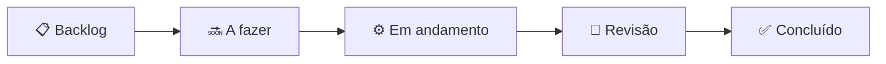

# Quadro Kanban — Clínica Mais Saúde

Retrato do fluxo de trabalho (atualizado em **26/10/2026**). O quadro reflete a situação das histórias do
[Product Backlog](PRODUCT_BACKLOG.md). Política de **WIP** (trabalho em progresso): no máximo **1–2 itens**
em *Em andamento* — o projeto é conduzido por uma equipe enxuta, priorizando fluxo contínuo.

## Fluxo

## Quadro (snapshot)

| 📋 Backlog | 🔜 A fazer | ⚙️ Em andamento | ✅ Concluído (recentes) |
|-----------|-----------|-----------------|--------------------------|
| E5-03 Push nativo FCM | E6-08 APK do app Android (EAS) | **Monografia ABNT** (integração das entregas de out/2026) | E8-05 Publicação no Azure |
| E8-07 Troca de imagem e migrations no CD | Revisão final da monografia | | E4-11 Termos LGPD oficiais (v2.0) |
| E7-04 Painel de indicadores | | | E4-10 Fila de solicitações paginada |
| E1-09 Permissão "Gerenciar pacientes" | | | E1-11 Sessão de 15 min com renovação |
| E1-08 Caminho duplicado nas tabelas de identidade | | | E1-10 Autorização por recurso |
| 2º fator no 1º acesso · Multi-tenant *(fora do escopo atual)* | | | E6-06/07 Calendário e perfil enxuto (mobile) |

## Regras de política (Definition of Done)

Um item só entra em **✅ Concluído** quando:
1. Código compila (build .NET 0 erros / `tsc` limpo) e passa nos **testes automatizados**.
2. A **CI** (GitHub Actions) está verde.
3. Mudança de schema tem **migration** aplicada e, quando aplicável, artefato de banco atualizado.
4. Alterações de fluxo foram **validadas** (homologação E2E, *smoke test* ou verificação no device).
5. Commit(s) na branch `teste` com mensagem descritiva.

## Métricas de fluxo (visão geral)

- **312 commits** entre 07/04 e 26/10/2026 · picos de entrega em maio (features), agosto (refactor + mobile) e
  outubro (segurança, paridade mobile e publicação).
- **172 testes** automatizados no backend (domínio, aplicação, API e infraestrutura) + `tsc` (web/mobile) na CI.
- Cadência: entregas incrementais frequentes; sem *sprints* de duração fixa (fluxo Kanban orientado a tema).
