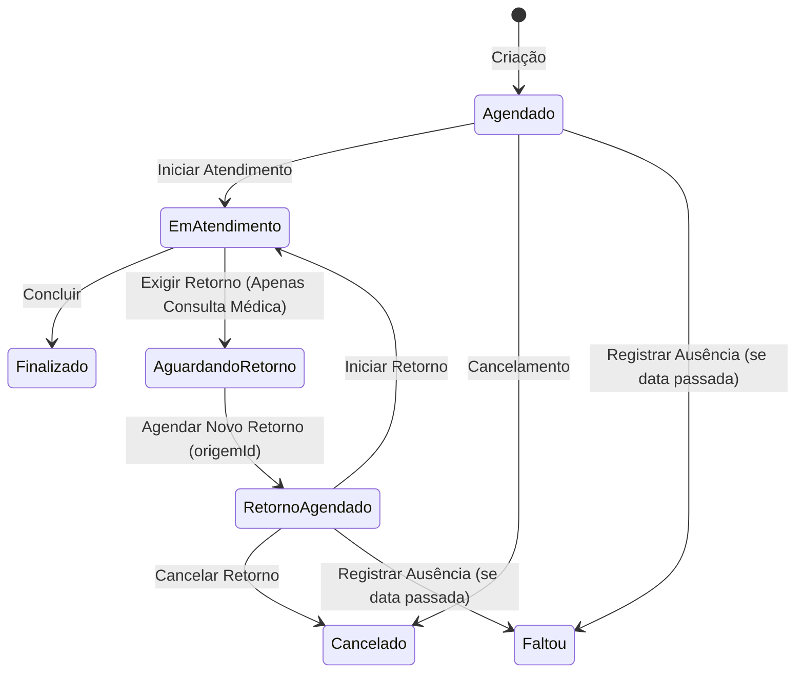

# 🏥 Clínica Mais Saúde — Documento de Requisitos e Regras de Negócio

Este documento apresenta os requisitos e todas as regras de negócio consolidadas do sistema **Clínica Mais Saúde**, servindo como única fonte da verdade funcional do projeto.

---

## 1. Requisitos Funcionais (RF)

Os Requisitos Funcionais descrevem as ações e funcionalidades que o sistema fornece aos usuários (Pacientes, Profissionais de Saúde e Administradores).

*   **RF01 - Gestão de Autenticação e Autorização:** O sistema deve permitir o login seguro de usuários (Pacientes, Médicos, Enfermeiras e Administradores) por e-mail ou CPF, utilizando controle de acesso baseado em perfis (RBAC - Role-Based Access Control) via JWT.
*   **RF02 - Gestão de Pacientes:** O sistema deve permitir o cadastro, edição e visualização de dados de pacientes, incluindo nome, CPF, e-mail, telefone e foto de perfil (com opção de remover a foto e voltar ao avatar com a inicial do nome).
*   **RF03 - Gestão de Profissionais:** O sistema deve permitir o cadastro de profissionais de saúde, especificando seu tipo (Médico, Enfermeira), CRM e especialidades médicas vinculadas.
*   **RF04 - Agendamento de Consultas:** O sistema deve permitir a criação, reagendamento, cancelamento e alteração de status de consultas. Ao concluir o agendamento, o paciente vê o profissional delegado (nome e foto).
*   **RF05 - Triagem Inteligente com IA:** O sistema deve possuir integração com inteligência artificial para sugerir especialidades médicas adequadas a partir dos sintomas livres relatados pelo paciente, contando com bloqueios de abuso e injeção de prompt.
*   **RF06 - Gestão de Status de Agendamentos:** O sistema deve evoluir e validar o status do agendamento de acordo com uma máquina de estados estrita.
*   **RF07 - Dashboard Analítico de Gestão:** O sistema deve apresentar um painel contendo métricas operacionais para Administradores (taxa de absenteísmo, volume de consultas, distribuição por especialidades).
*   **RF08 - Exportação de Relatórios:** O sistema deve permitir a exportação de relatórios gerenciais nos formatos PDF (QuestPDF) e Excel (ClosedXML).
*   **RF09 - Trilha de Auditoria (Audit Trail):** O sistema deve registrar de forma inalterável todas as criações, remarcações, cancelamentos e alterações de status de consultas na tabela de histórico (`AgendamentoHistoricos`), identificando o usuário responsável.
*   **RF10 - Sistema de Notificações:** O sistema deve notificar os usuários em tempo real (SignalR) sobre agendamentos, cancelamentos, remarcações, lembretes de consulta e resultados de exame disponíveis, com links para o registro correspondente.
*   **RF11 - Auto-cadastro Moderado:** O paciente deve poder solicitar o próprio cadastro (web ou mobile) em etapas: aceite dos termos (LGPD) → dados pessoais → verificação do e-mail por código → Declaração de Saúde. A clínica avalia presencialmente e aprova ou recusa a solicitação; o paciente aprovado faz o **primeiro acesso** (código por e-mail + CPF) e define a senha. A recusa é comunicada por e-mail com o motivo.
*   **RF12 - Editor da Declaração de Saúde:** O Administrador deve poder criar e editar modelos de Declaração de Saúde (perguntas, ordem e modelo vigente). Um modelo já respondido fica travado para alterações estruturais.
*   **RF13 - Recuperação de Senha:** O usuário deve poder redefinir a própria senha por código enviado ao e-mail cadastrado, sem depender da recepção.
*   **RF14 - Aplicativo Mobile do Paciente:** O paciente deve poder executar todo o seu fluxo pelo celular (cadastro, login com biometria, triagem por IA, agendamento manual e de retorno, consultas, notificações, perfil e exclusão de conta). Médicos, enfermeiras e administradores usam apenas a versão web.
*   **RF15 - Exclusão de Conta:** O paciente deve poder encerrar a própria conta (confirmando a senha), com desativação lógica (*soft-delete*) e revogação das sessões ativas.
*   **RF16 - Acolhimento em Crise Emocional:** Quando a triagem identificar relato de sofrimento emocional grave (automutilação ou ideação suicida), o sistema deve acolher o paciente com uma mensagem de apoio e o contato do CVV (188), e perguntar se ele deseja agendar com Psiquiatria — sem nenhuma punição.

---

## 2. Requisitos Não Funcionais (RNF)

Os Requisitos Não Funcionais definem as premissas técnicas, restrições arquiteturais, performance e segurança.

### 2.1 Arquitetura e Stack Tecnológica
*   **RNF01 - Backend (API):** Desenvolvido em **.NET 10 (ASP.NET Core)** utilizando o padrão **Clean Architecture** (Domain, Application, Infrastructure, API).
*   **RNF02 - Frontend Web (SPA):** Desenvolvido em **React 19 com TypeScript**, utilizando **Vite** e **Tailwind CSS v3**.
*   **RNF03 - Persistência:** Banco de dados relacional **SQL Server** mapeado via **Entity Framework Core** (migrations).
*   **RNF04 - Mobile:** Desenvolvido em **React Native com Expo** (expo-router), consumindo a mesma API REST do web.

### 2.2 Segurança
*   **RNF05 - Autenticação JWT:** Tokens de acesso assinados digitalmente com HMAC-SHA256. Janela de expiração de **3 horas** para sessões ativas e **7 dias** para tokens de renovação (Refresh Tokens), com rotação.
*   **RNF06 - Chaves Primárias:** Uso do tipo **`Guid` (UUID)** gerado pela aplicação para chaves primárias. É proibido expor IDs numéricos sequenciais (exceção: tabelas de *lookup* de enums).
*   **RNF07 - Criptografia de Senhas:** Senhas devem ser salvas usando o algoritmo hash **BCrypt**. Códigos enviados por e-mail são guardados como HMAC-SHA256 com *pepper* (nunca em texto puro).
*   **RNF08 - Segredos fora do código:** Chaves (JWT, Gemini, SMTP, *pepper*) vêm de configuração por ambiente (User Secrets em desenvolvimento, variáveis de ambiente em produção).
*   **RNF09 - Limite de Requisições:** Login limitado a 20 tentativas por minuto por IP; endpoints públicos de recuperação/cadastro também são limitados por IP.

### 2.3 Performance
*   **RNF10 - Paginação Server-Side:** Consultas de listagem longa devem ser paginadas diretamente no banco de dados usando os métodos de skip/take do Entity Framework Core.
*   **RNF11 - Otimização de Leitura:** Requisições GET (leitura pura) no Entity Framework devem utilizar o método **`.AsNoTracking()`**.

### 2.4 Interface, Usabilidade e Acessibilidade
*   **RNF12 - Design System:** Interface no design system *navy* (primária `#2C5282`, tipografia Inter, superfícies planas com borda, ícones Lucide no web), aplicado ao web e ao mobile. O web é voltado a desktop; o celular é atendido pelo app.
*   **RNF13 - Resiliência Visual:** O frontend deve tratar de maneira global as requisições assíncronas, fornecendo avisos limpos e impedindo travamento de tela (*White Screen of Death*).
*   **RNF14 - Acessibilidade:** O web oferece tradução para Libras (VLibras) e atalho "pular para o conteúdo"; o mobile usa rótulos de acessibilidade nos fluxos principais.

---

## 3. Regras de Negócio Gerais (RN)

*   **RN01 - Sanitização de Dados:** A higienização de inputs e remoção de máscaras (CPF, Telefones) deve ser feita no Backend (camada Application/Services). O Frontend envia os dados brutos.
*   **RN02 - Segurança de Acesso (Bloqueio por Força Bruta):** Se um usuário realizar 5 tentativas incorretas de senha seguidas, a conta é bloqueada temporariamente por 15 minutos. A mensagem de erro é genérica (não revela se a conta existe).
*   **RN03 - IA - Rate Limiting & Proteção contra Abuso:**
    *   **Limites de Uso:** O processamento de sintomas por IA é limitado a 100 chamadas globais por hora no sistema e a 5 chamadas diárias por usuário.
    *   **Prompt Injection:** Tentativas deliberadas de burlar as regras de segurança causam o banimento permanente da conta (situação `Banido`), o cancelamento automático das consultas futuras ativas e o disparo de notificação aos administradores.
    *   **Uso Indevido:** Sintomas sem relação com saúde são registrados como violação e notificados aos administradores. Na 2ª violação a IA fica bloqueada por 1 dia; da 3ª em diante, por 7 dias.
    *   **Crise Emocional:** Relatos de sofrimento emocional grave nunca são punidos — o sistema acolhe (RF16). Recusas de processamento do provedor de IA por segurança também não punem.
*   **RN04 - Visibilidade de Agendamentos:** O paciente vê apenas os próprios agendamentos; o médico e a enfermeira veem apenas os agendamentos delegados a eles; o administrador vê todos. Consultar o agendamento de outra pessoa retorna "não encontrado".
*   **RN05 - Auto-cadastro:** Só pode existir uma solicitação de cadastro em análise por CPF; o CPF é validado pelo dígito verificador e não pode pertencer a uma conta já existente. O e-mail precisa ser verificado por código antes do envio da solicitação.

---

## 4. Regras de Negócio do Módulo de Agendamentos (RN-AG)

### 4.1 Matriz de Permissões Clínicas
O tipo do profissional de saúde restringe estritamente o tipo de consulta que ele está habilitado a executar:

| Tipo de Consulta | Enfermeira(o) | Médico(a) |
|---|---|---|
| Triagem | ✅ | ❌ |
| Exame | ✅ | ❌ |
| Vacina | ✅ | ❌ |
| Consulta Médica | ❌ | ✅ |
| Retorno | ❌ | ✅ |

### 4.2 Especialidades Médicas Válidas
As especialidades médicas suportadas pelo sistema e cadastradas no backend (`EspecialidadeMedica.cs`) são:
*   Clínica Geral (0)
*   Medicina de Família (1)
*   Pediatria (2)
*   Ginecologia e Obstetrícia (3)
*   Cardiologia (4)
*   Dermatologia (5)
*   Endocrinologia (6)
*   Gastroenterologia (7)
*   Neurologia (8)
*   Ortopedia e Traumatologia (9)
*   Psiquiatria (10)
*   Otorrinolaringologia (11)
*   Oftalmologia (12)
*   Urologia (13)
*   Pneumologia (14)
*   Reumatologia (15)
*   Geriatria (16)
*   Medicina Esportiva (17)

### 4.3 Duração das Consultas e Slots de Agendamento
Cada tipo de consulta tem uma duração padronizada em minutos:
*   **Vacina:** 15 minutos
*   **Triagem:** 20 minutos
*   **Retorno:** 20 minutos
*   **Exame:** 30 minutos
*   **Consulta Médica:** 40 minutos

**Horário de funcionamento:** segunda a sexta, das 08:00 às 18:00, com almoço fixo das 12:00 às 13:00. Sem expediente aos fins de semana.

### 4.4 Validação de Conflito de Horário Inteligente
É proibido realizar agendamentos que gerem sobreposição de horários para um mesmo Profissional ou para um mesmo Paciente. A sobreposição é calculada em tempo real com base no início e término previsto da consulta (utilizando a duração do slot):
```
(Novo_Inicio >= Existente_Inicio E Novo_Inicio < Existente_Fim) OU
(Novo_Fim > Existente_Inicio E Novo_Fim <= Existente_Fim) OU
(Novo_Inicio <= Existente_Inicio E Novo_Fim >= Existente_Fim)
```

### 4.5 Auto-delegação e Balanceamento de Carga
*   **Atribuição Automática:** Pacientes e recepcionistas não selecionam o profissional de saúde diretamente na criação do agendamento (exceto no fluxo de Retorno). O backend delega o profissional automaticamente.
*   **Lógica de Delegação:** O sistema filtra os profissionais do tipo correto (Matriz de Permissões) e habilitados na especialidade selecionada (se for médico). Dentre os candidatos livres e sem conflito de horário no slot, o agendamento é atribuído àquele com o **menor volume de consultas no dia**; em caso de empate, vence o de menor volume de consultas ativas.

### 4.6 Regras Estritas de Agendamento
*   **Não Retroatividade:** É proibido efetuar agendamentos para datas e horários passados.
*   **Agendamento por Terceiros:** Pacientes no portal de autoatendimento só podem efetuar agendamentos vinculados ao seu próprio `PacienteId` obtido através das claims JWT.
*   **Limite Diário de Consultas Ativas (Limite A):** Um paciente pode possuir no máximo 2 agendamentos ativos (não finalizados/cancelados) agendados para a mesma data.
*   **Limite Diário de Criações (Limite B):** Um paciente pode criar no máximo 3 agendamentos no mesmo dia civil (evitando criação maliciosa em massa).
*   **Especialidade Ativa Única:** Um paciente só pode ter no máximo **um** agendamento ativo por especialidade médica simultaneamente.
*   **Carência de 60 Dias:** Se um paciente tiver realizado e finalizado uma consulta de uma determinada especialidade médica nos últimos 60 dias, ele fica proibido de marcar um novo agendamento autônomo pelo portal para esta especialidade (novos agendamentos neste intervalo devem ser marcados presencialmente/pela recepção).
*   **Remarcação pelo Paciente:** O paciente pode remarcar a própria consulta, informando o motivo, sujeito aos limites diários, à especialidade ativa única e aos conflitos de horário.
*   **Vínculo do Profissional em Retornos:**
    *   Um agendamento do tipo "Retorno" só pode ser criado se houver uma consulta inicial anterior concluída com status de `AguardandoRetorno`.
    *   O agendamento de retorno é travado obrigatoriamente ao mesmo profissional que atendeu a consulta inicial de origem, herdando o `ProfissionalId` e ignorando a regra de balanceamento de carga.

### 4.7 Máquina de Estados e Transições de Status
O ciclo de vida do agendamento obedece rigidamente à seguinte máquina de estados, e qualquer transição fora do fluxo descrito é rejeitada:



#### Regras das Transições:
*   **Iniciar Atendimento (➔ EmAtendimento):** Só é permitido iniciar a consulta a partir de no máximo **15 minutos de antecedência** do horário agendado.
*   **Exigir Retorno (➔ AguardandoRetorno):** Apenas permitido se o tipo da consulta for `Consulta Médica` e o status atual for `EmAtendimento`.
*   **Agendar Novo Retorno (➔ RetornoAgendado):** Ativado na consulta de origem automaticamente quando a recepção/paciente agenda o retorno vinculado.
*   **Registrar Ausência (➔ Faltou):** Só é permitido transicionar um agendamento (`Agendado` ou `RetornoAgendado`) para `Faltou` se a data e hora prevista da consulta já tiverem passado (bloqueado para datas futuras).
*   **Cancelamento (➔ Cancelado):** Pode ser efetuado por pacientes ou recepcionistas.
